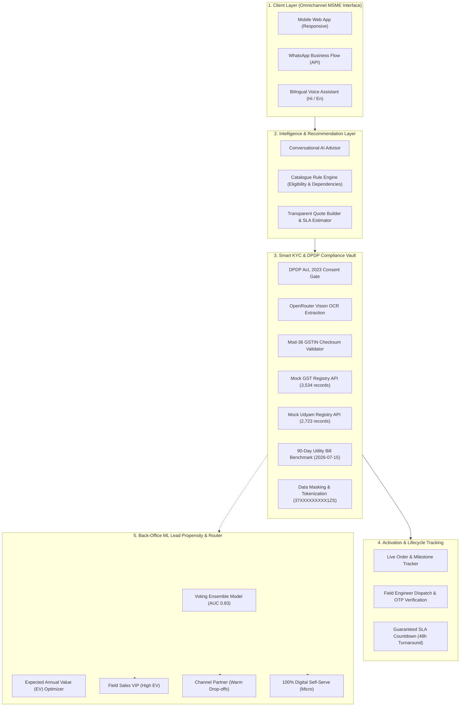
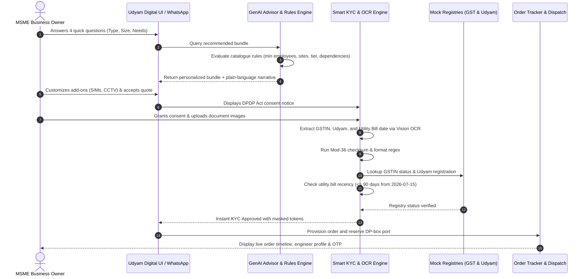

# Solution Architecture: Project Udyam Digital
## Accel Business (YTL Hackathon 2026 · Enterprise Track A)

---

### 1. Executive System Overview

Project Udyam Digital is an omnichannel, digital-first acquisition, quoting, verification, and onboarding platform engineered specifically for Indian Micro, Small, and Medium Enterprises (MSMEs). It replaces manual paper visits with a **60-second conversational journey**, near-instant automated KYC, and a live activation tracker that directly tackles the main drivers of funnel drop-off and customer churn.

---

### 2. End-to-End Sequence Flow

---

### 3. Core Architectural Modules

#### A. GenAI Conversational Advisor
* **Multi-turn Context:** Translates natural language business descriptions into technical telecommunication parameters (bandwidth, static IPs, failover links, cloud POS).
* **Hard Rule Constraint Engine:** Validates that products meet catalogue thresholds:
  * Minimum site and employee requirements.
  * City tier eligibility (Tier 1 vs Tier 2).
  * Dependency resolution (`requires_one_of` guarantees dependent products like Cloud Telephony or SD-WAN have underlying connectivity).
  * GSTIN requirement flags (`requires_gstin = 'Y'`).

#### B. Smart Instant KYC Engine
* **Vision OCR Processing:** Multimodal LLM / OCR parsing extracts registration tokens and utility bill issue dates with zero manual keying.
* **Algorithmic Validation:**
  * **Mod-36 Checksum:** Verifies 15-character GSTIN integrity, handling synthetic PAN entity character `'X'`.
  * **Registry Lookups:** Queries `mock_gstin_registry.csv` and `mock_udyam_registry.csv` to ensure active status and flag cancelled entities (e.g. Applicant K01).
  * **Recency Benchmark:** Computes date difference against `2026-07-15`, rejecting address proofs older than 90 days (e.g. Applicants K01, K11, K12).

#### C. Live Milestone Order Tracker
* **Real-time Status Feed:** Replaces asynchronous, paper-based waiting with 5 clear stages: Order Confirmed $\to$ KYC Cleared $\to$ Line Feasibility $\to$ Technician Dispatched $\to$ Activated.
* **Technician Handshake:** Direct engineer contact details and OTP verification guarantee zero confusion during line laying and hardware provisioning.
* **Business Impact:** Directly eliminates the 3.0 follow-up calls per lead that drove 28% of 6-month churn.

#### D. ML Propensity & Expected Value (EV) Lead Router
* **Ensemble Architecture:** Soft Voting Ensemble combining Random Forest, Gradient Boosting, HistGradientBoosting, and L2-regularized Logistic Regression (ROC-AUC ~ 0.83).
* **Expected Value Formulation:**
  $$\text{Expected Annual Value (EV)} = P(\text{Activation}) \times \text{Predicted MRR} \times 12$$
* **Omnichannel Triage:**
  1. **Field Sales VIP:** High propensity + high predicted MRR ($\ge$ ₹6,000/mo).
  2. **Channel Partner Outreach:** Warm digital drop-offs (leads stalled at quote or KYC).
  3. **100% Self-Serve Digital:** Micro-retail and price-sensitive leads, operating at near-zero CAC.

